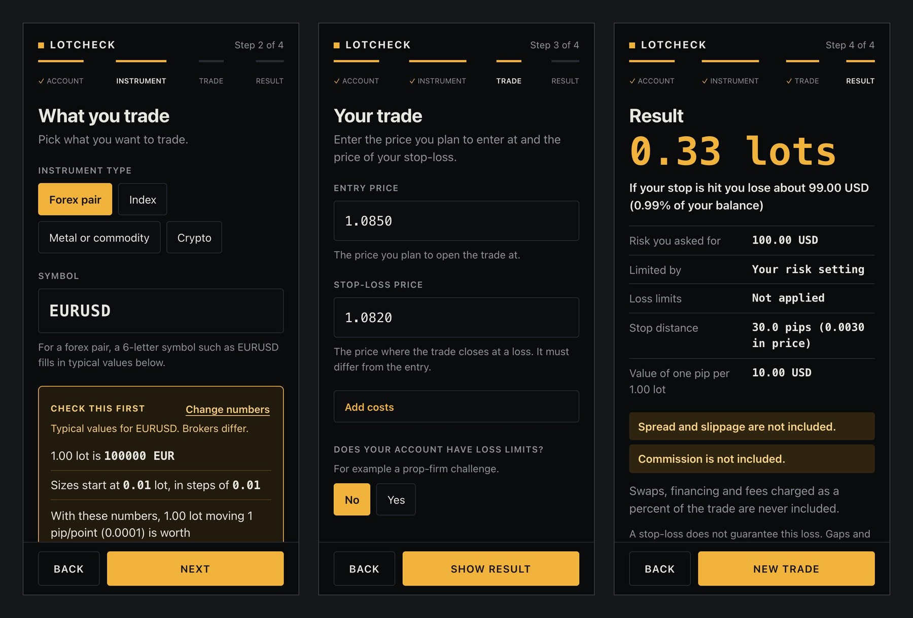

# Lotcheck

A free, offline position-size calculator for beginner traders, with an optional loss-room cap for accounts that have loss limits (for example prop-firm challenges).



## Get it

You do not need an account or any software. Three steps:

1. Open the file `dist/lotcheck.html` in this repository on GitHub.
2. Press the download button (the arrow, "Download raw file"). Your browser saves the file.
3. Double-click the saved file. It opens in your browser. The page takes you through four steps, one screen at a time: your account, what you trade, your trade, and the result. Press Next to move on and Back to change something.

It works with no internet connection. Nothing is installed. Numbered releases may be offered later.

## Check your numbers first

Lotcheck is only as right as the numbers you give it. Contract size and point value are different for every broker and every instrument. One broker may count an index as 1 unit per point. Another may count it as 10 or 100. If this number is wrong, the lot size is wrong, and it can be wrong by a factor of 10 or more.

So Lotcheck shows a **check line** on the Instrument step. It says what 1.00 lot is worth when the price moves by one pip or point. Compare that figure with the same figure in your trading platform. If they differ, one of your numbers is wrong.

For every instrument type, forex included, you must tick "I have checked these numbers in my platform" before a lot size is shown. Changing the account currency or any instrument field unticks it. Values the page pre-fills for a recognised currency pair are only typical values, so check them too.

See [docs/finding-your-numbers.md](docs/finding-your-numbers.md).

## What it does

- Works out a lot size from your risk and your stop distance.
- Rounds the size **down** to the lot step. It never rounds **up** to the minimum lot. If no allowed size fits your risk, it shows no size and says so.
- Requires the minimum lot to be a whole number of lot steps.
- Converts the instrument's profit and loss currency into your account currency. For a cross pair you type the market price of a currency pair, and the page shows the rate back to you as a sentence so you can check the direction. That price can move before your stop is hit, and the real loss moves with it.
- For pairs that start with your account currency (a USD account trading USDJPY, a EUR account trading EURUSD), converts the loss at your stop-loss price, so no conversion price is needed and the loss is not understated. This applies to every instrument type (for example a BTC account trading BTCUSD). For forex pairs the page asks for the base currency, because a symbol with extra letters in front (for example "mUSDJPY") cannot be recognised from the symbol alone.
- Optionally includes commission and extra distance for spread or slippage, and tells you when either is left at zero. It never includes swaps, financing or fees charged as a percent of the trade.
- Optionally shows an estimated margin, if you enter leverage. It uses the one leverage figure you enter. Brokers may use a different margin rate for each instrument.
- Optionally caps the risk to the loss room left under your account's daily and total loss limits. The limits apply only when you answer Yes to "Does your account have loss limits?". It warns when a size would end exactly on a limit, when your equity is above the highest value you entered, and that a trailing floor is treated as a snapshot.

How the numbers are worked out: [docs/how-it-works.md](docs/how-it-works.md). Loss limits: [docs/loss-limits.md](docs/loss-limits.md).

## What it does not do

- It does not trade. It places no orders.
- It gives no signals, no direction and no advice.
- It uses no live prices. You type every number.
- It does not connect to any account.
- It pre-fills values only for recognised currency pairs, and marks them as typical values to check. Nothing is pre-filled for metals, commodities, indices or crypto. If a symbol is not a recognised currency pair, nothing is filled in and a caution tells you to check the instrument type.
- It has no firm or broker presets. Rules differ and change, so you enter your own.
- No data leaves your device. There is no tracking and no analytics.

## Verify your download

The build publishes a checksum for the page in `dist/SHA256SUMS`. Compare it with the checksum of the file you saved.

macOS and Linux:

```
shasum -a 256 lotcheck.html
```

Windows (Command Prompt or PowerShell):

```
certutil -hashfile lotcheck.html SHA256
```

The result must match the value for `lotcheck.html` in `dist/SHA256SUMS`. If it does not, do not use the file.

What this check proves: the file you saved was not damaged or changed on the way from this repository. What it does not prove: that the repository itself can be trusted. Both the file and its checksum come from the same place.

## For developers

Requirements: Node 22 or newer. There are no dependencies to install.

```
npm test                          # unit, property and golden tests
python3 test/golden/reference.py  # second implementation, cross-checks the golden cases
npm run build     # builds dist/lotcheck.html and dist/SHA256SUMS
npm run check     # build, then test
```

The calculation core is plain ES modules and can be used on its own. All numbers go in as decimal strings. All results are exact rationals (`Q`).

```js
import { calculatePositionSize, calculateLossRoom, sizeWithGuard, Q } from "./src/core/index.js";

const size = calculatePositionSize({
  accountCurrency: "USD",
  balance: "10000",
  risk: { mode: "percent", value: "1" },
  instrument: {
    symbol: "EURUSD",
    quoteCurrency: "USD",
    contractSize: "100000",
    pipSize: "0.0001",
    minLot: "0.01",
    lotStep: "0.01",
    maxLot: null,
  },
  trade: { entry: "1.0850", stop: "1.0830", extraDistance: "0" },
});

console.log(size.status);                    // "ok"
console.log(size.lots.toFixed(2, "down"));   // "0.50"
console.log(size.actualRisk.toFixed(2, "up")); // "100.00"
```

`instrument.baseCurrency` (for example `"EUR"` for EURUSD) is optional. When the instrument is itself the pair of your account currency and the quote currency, the loss is converted at the stop-loss price and `conversion` must be left out. Lotcheck detects this from `baseCurrency`. If you leave `baseCurrency` out, it looks at the symbol: after trimming, upper-casing and dropping every character that is not a letter or digit, a symbol that starts with the account currency followed by the quote currency ("USDJPY", "usd/jpy", "USDJPY.m" in a USD account with JPY as the quote) counts as that pair. An explicit `baseCurrency` wins over the symbol, with one exception: if the symbol starts with the account currency followed by the quote currency and the `baseCurrency` you pass is not the account currency, Lotcheck throws an `InputError` (field `instrument.baseCurrency`, code `conflict`). A symbol with a letter in front, such as "mUSDJPY", is not detected from the symbol, so pass `baseCurrency` yourself.

Numbers, symbols and currency codes are trimmed of spaces, tabs and line breaks only. For a number or a currency code, any other leading or trailing character (for example a no-break space) is a `format` error.

If you pass a conversion price for a pair that the traded instrument itself is, the loss is under-stated. Pass `baseCurrency` or a plain symbol so Lotcheck can detect it.

`calculateLossRoom` and `sizeWithGuard` also return `notes`, for example `"equity-above-high-water-mark"`. The size result `notes` can include `"capped-at-max-lot"`, `"risk-above-2-percent"`, `"no-spread-entered"`, `"no-commission-entered"`, `"margin-above-balance"` and `"loss-equals-room"`.

`calculateLossRoom(guardInput)` returns the loss room under daily and total limits. `sizeWithGuard(sizingInput, guardInput)` returns `{ room, size }`, with the size capped to the room left. Bad input throws an `InputError` with a `field` and a `code`.

See [CONTRIBUTING.md](CONTRIBUTING.md) before changing any formula.

## Roadmap: the toolkit

Lotcheck is the first module of a planned toolkit. **None of the following is built yet.**

- Statement reader for trade-history exports.
- Honest stats report with small-sample warnings.
- Risk-of-ruin explainer.
- Optional read-only account import through a broker API, for users who register their own API application.

See [docs/toolkit.md](docs/toolkit.md).

## Security

See [SECURITY.md](SECURITY.md).

## Licence

MIT. See [LICENSE](LICENSE).

## Disclaimer

Lotcheck is a calculator, not financial advice. A stop-loss does not guarantee the loss: gaps and slippage can make the real loss larger. Trading leveraged products can lose more than you expect, including more than you deposited with some providers. Check every result against your own platform. Lotcheck is not affiliated with any broker, trading platform or prop firm. Product names belong to their owners.
